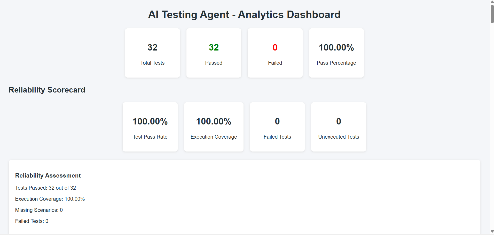
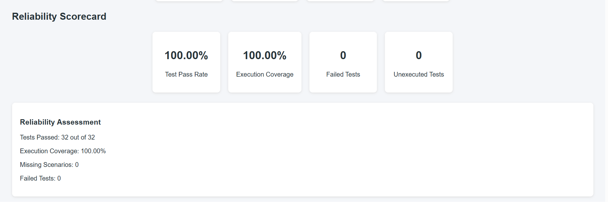
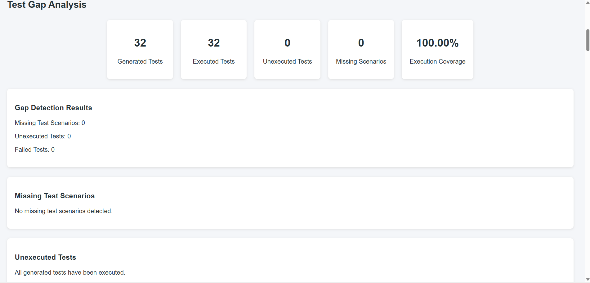
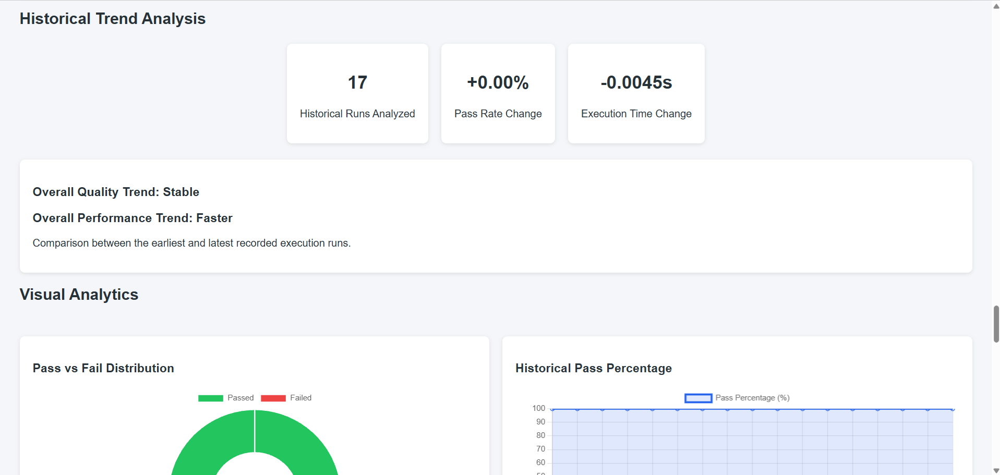
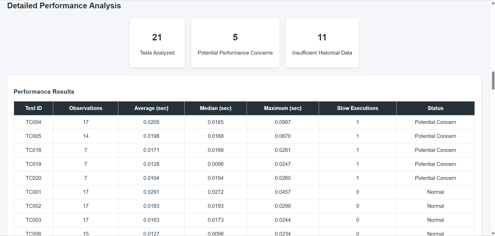
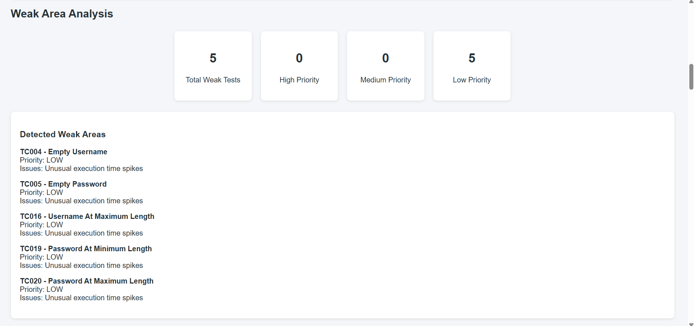
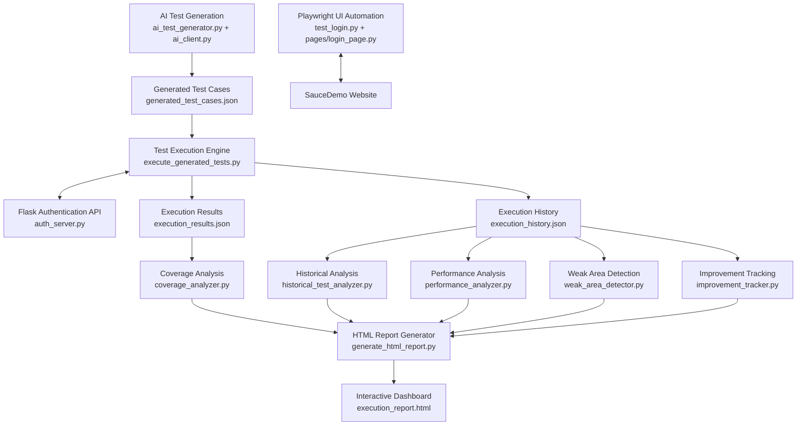

# AI-Powered Software Testing Agent

An AI-assisted software testing automation framework that generates API test scenarios, executes automated tests, analyzes coverage and performance, tracks historical results, and produces an interactive HTML dashboard.

**Built with Python, Pytest, Playwright, Flask, and OpenAI API.**

## Project Overview

The AI-Powered Software Testing Agent aims to reduce manual testing effort by combining traditional software test automation with AI-assisted test generation and intelligent test analysis.

The framework can execute test scenarios against a local authentication API, analyze execution results, identify potential testing gaps, monitor historical performance, and generate a consolidated HTML dashboard.

## Key Features

- **UI Automation:** Automates browser-based login scenarios using Playwright and Pytest.
- **API Testing:** Tests REST API endpoints using Python Requests.
- **AI-Based Test Generation:** Generates API test scenarios using AI.
- **Batch Test Execution:** Executes generated test cases against a local Flask authentication API.
- **Coverage Analysis:** Identifies missing, unexecuted, and failed test scenarios.
- **Historical Test Analysis:** Tracks test results across multiple execution runs.
- **Performance Analysis:** Identifies unusual test execution-time variations.
- **Weak Area Detection:** Highlights test cases that may require further investigation.
- **Improvement Tracking:** Compares recent test execution performance with historical results.
- **Interactive HTML Dashboard:** Presents test statistics, historical trends, performance analysis, and coverage insights.

## Technology Stack

| Technology | Purpose |
|---|---|
| Python | Core programming language |
| Pytest | Test execution and test framework |
| Playwright | Browser automation |
| Requests | REST API testing |
| Flask | Local authentication API |
| OpenAI API | AI-assisted test generation and recommendations |
| JSON | Test data, configurations, and execution results |
| HTML, CSS, JavaScript | Dashboard interface |
| Chart.js | Data visualization |
| Git and GitHub | Version control and project hosting |

## Dashboard Preview

The AI Testing Agent generates an interactive HTML dashboard that provides a consolidated view of test execution, coverage, historical trends, and performance analysis.

### 1. Dashboard Overview



### 2. Reliability Scorecard



### 3. Test Gap Analysis



### 4. Historical Trend Analysis



### 5. Performance Analysis



### 6. Weak Areas and Improvement Tracking



## Project Architecture




The project follows a modular architecture:

1. **Test Automation Layer:** Runs UI and API automation tests.
2. **AI Test Generation Layer:** Generates additional test scenarios and recommendations.
3. **Execution Layer:** Executes generated test cases against the local API.
4. **Analysis Layer:** Performs coverage, historical, performance, and weak-area analysis.
5. **Reporting Layer:** Combines the results into an interactive HTML dashboard.

## Project Structure

```text
ai-testing-agent/
│
├── api_tests/
│   ├── auth_server.py
│   ├── test_api.py
│   └── test_auth.py
│
├── pages/
│   ├── __init__.py
│   └── login_page.py
│
├── test_data/
│   └── login_data.json
│
├── ai_client.py
├── ai_test_generator.py
├── ai_gap_recommender.py
│
├── execute_generated_tests.py
├── generated_test_cases.json
├── execution_results.json
├── execution_history.json
│
├── coverage_analyzer.py
├── coverage_groups.json
├── coverage_suggestions.json
├── gap_analysis_report.json
│
├── historical_test_analyzer.py
├── history_analyzer.py
├── historical_analysis.json
├── trend_analyzer.py
│
├── performance_analyzer.py
├── performance_analysis.json
├── weak_area_detector.py
├── weak_area_analysis.json
├── improvement_tracker.py
├── improvement_tracking.json
│
├── failure_analyzer.py
├── generate_html_report.py
├── execution_report.html
│
├── main.py
├── test_login.py
├── test_playwright.py
├── test_logger.py
├── logger_config.py
├── read_json.py
│
├── README.md
└── .gitignore
```

The `.env` file, virtual environment, logs, screenshots, and Python cache files are kept locally and excluded from Git using `.gitignore`.

## Setup and Installation

### 1. Clone the repository

```bash
git clone https://github.com/Jangilishravan/ai-powered-testing-agent.git
cd ai-powered-testing-agent
```

### 2. Create a virtual environment

```bash
python -m venv venv
```

### 3. Activate the virtual environment

For Windows PowerShell:

```powershell
.\venv\Scripts\Activate.ps1
```

### 4. Install dependencies

```bash
pip install pytest pytest-html requests flask playwright openai python-dotenv
```

Install the Playwright browser:

```bash
playwright install
```

### 5. Configure environment variables

Create a `.env` file in the project root:

```env
OPENAI_API_KEY=your_openai_api_key
```

Never upload your actual API key to GitHub.

AI-powered features require a valid API key and a supported model configuration. Core test execution and analysis can be performed without enabling optional AI insights.

## Running the Project

### 1. Start the local Flask API

Open the first terminal:

```bash
python -m api_tests.auth_server
```

The local API will run at:

```text
http://127.0.0.1:5000
```

Keep this terminal running while executing authentication tests.

### 2. Run API tests

```bash
pytest api_tests/test_api.py -v
```

### 3. Run authentication tests

```bash
pytest api_tests/test_auth.py -v
```

### 4. Execute generated test cases

```bash
python execute_generated_tests.py
```

This executes the generated scenarios and records their results.

Some AI-related operations may consume OpenAI API credits.

### 5. Run coverage analysis

```bash
python coverage_analyzer.py
```

### 6. Run historical analysis

```bash
python historical_test_analyzer.py
```

### 7. Run performance analysis

```bash
python performance_analyzer.py
```

### 8. Run weak-area detection

```bash
python weak_area_detector.py
```

### 9. Run improvement tracking

```bash
python improvement_tracker.py
```

### 10. Generate the HTML dashboard

```bash
python generate_html_report.py
```

Open the report:

```powershell
Start-Process execution_report.html
```

Optional AI-generated dashboard insights are disabled by default to conserve API credits.

## Current Project Results

The following results were verified during a development execution:

| Metric | Result |
|---|---:|
| Generated Test Cases | 32 |
| Executed Test Cases | 32 |
| Passed Test Cases | 32 |
| Failed Test Cases | 0 |
| Execution Coverage | 100% |
| Pass Percentage | 100% |
| Historical Runs | 17 |
| Detected Weak Areas | 5 |

**Note:** The 100% execution coverage represents all 32 generated test cases being executed. It does not mean every possible application scenario has been tested. Results may change as the project evolves.

## Future Enhancements

- Integration with CI/CD pipelines.
- Support for additional API endpoints and applications.
- More advanced AI-based test recommendations.
- Automated test scheduling.
- Enhanced dashboard filtering and report export.
- Expanded test coverage and reliability analysis.

## Author

**Jangili Shravan Kumar**

GitHub: [Jangilishravan](https://github.com/Jangilishravan)